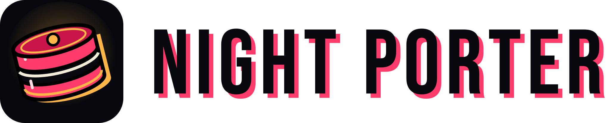

<h1>
  <picture>
    <source media="(prefers-color-scheme: dark)" srcset="assets/wordmark-dark.svg" />
    
  </picture>
</h1>

**Handles your PRs while you're away.**

[Website](https://night-porter.com) · [Demo video](https://www.youtube.com/watch?v=vjD-h2O7WUI) · [Docs](https://docs.night-porter.com) · [X](https://x.com/NightPorterDev) · [Bluesky](https://bsky.app/profile/did:plc:zojgcz6b634zmhrkl7hjlozs) · [Mastodon](https://mastodon.social/@nightporter)

Night Porter is like an IRC bouncer for your pull requests. It watches GitHub, GitLab and Forgejo/Gitea
(Codeberg) for review comments, failing CI and merge conflicts on your PRs and MRs, then runs a coding agent
(Claude Code, OpenCode, Codex, or Gemini CLI as an experimental option) on your local clone to deal with them, within the rules you set.

Most agent tools are cockpits: you start the agent and watch it. Night Porter is the night
shift. It starts work **by itself** when something happens on your PRs, and it's built to be safe
when that something was written by a stranger.

> Status: early development (0.x). Expect breaking changes.

## How it works

1. **Watch.** A small daemon polls GitHub and Forgejo/Gitea notifications and your open GitLab MRs
   (no webhooks, no public endpoint).
2. **Filter.** Only repos you subscribed to, only events you enabled, and only from people you
   trust. Comments from strangers wait in an inbox until you decide.
3. **Work.** After a short quiet period, Night Porter batches the new activity on a PR and runs
   your agent in a separate git worktree. Your own checkout is never touched.
4. **Check.** Night Porter checks the agent's commits for secrets, protected files, dependency
   changes and size before anything leaves your machine.
5. **Act, or ask.** Depending on the autonomy level, Night Porter pushes and replies on its own,
   or waits for you in the TUI.

## Autonomy levels

| level | what happens |
|---|---|
| `observe` | notify only |
| `suggest` | agent commits locally; you get copy-paste reply text and a push command, and Night Porter posts nothing |
| `draft` | agent commits; Night Porter pushes and replies after you approve |
| `auto` | Night Porter pushes and replies on its own (pre-push checks still apply) |

Night Porter **never** merges, force-pushes or closes, and approves a PR only as a review you opted into (`review_verdicts`) and approved yourself.

## Features

- GitHub (github.com), GitLab (gitlab.com and self-hosted, for example `git.drupalcode.org`) and
  Forgejo/Gitea (codeberg.org, gitea.com and self-hosted)
- Claude Code, OpenCode, Codex and Gemini CLI (experimental: not yet tested against a real Gemini CLI)
- Trust rules by role, user, team or bot, plus an inbox for anyone not yet trusted
- Per-repo settings for triggers, autonomy, agent (and a model per agent), schedule, reply style
  and environment
- Several active windows per day; events outside them are queued. Each window can set its own
  level, agent and notifications (draft by day, auto overnight)
- Desktop notifications, plus webhooks (Slack, Discord, ntfy, JSON) and commands for your phone
  or chat; `nightporter notify test` checks them
- Reply styles (`concise`, `detailed-tech-lead`, `non-technical`, or your own), with an optional
  AI-disclosure footer (or no trace at all, per repo)
- Environment hooks for projects that need a running stack (DDEV, Docker, …)
- Maintainer mode: triage, reproduce, fix or review issues and MRs from others, on request, or
  sweep a whole backlog (`nightporter sweep`) by label and age; triage flags issues that are
  already done
- Packs and marketplaces: shareable review steps, reply styles and environment presets
- Fix a job up before it goes out: edit its replies in your editor (`e`), or change files in its
  worktree and `amend` (`m`): checked again, no take-over needed
- Plan first (`plan_first`): chosen kinds of job write a plan and wait for your OK before any code
- Gets better with use: `nightporter learn` turns your fixes into better per-repo instructions
  (you approve the diff), and `nightporter stats` shows cost and how often you had to step in
- Dismiss a job without replying or pushing, undo it, or delete it for good; search History for
  done and dismissed jobs
- One view per repo (`nightporter repo <owner/name>`) of everything that shapes its jobs: level,
  agent, prompt files, reply style, trust, hours and checks
- Control jobs from your phone: comment `/nightporter approve`, `dismiss`, `retry` or `status` on
  the PR or MR (only your own account counts)
- Start and stop from the TUI (`D`) or `nightporter start` / `nightporter stop`
- A once-a-day, anonymous check for a new release (`check_updates`); it never updates itself
- Leaves no files in your repositories (it uses its own branches and worktrees)

## Works with herdr, Rex, tmux and Zellij

[herdr](https://herdr.dev) and [Rex](https://www.superlogical.com/rex) are where you run and
watch agents; Night Porter is what runs while you're not there. They fit together:

- **Take over a job.** On a finished or waiting job, press `h` in the TUI (or run
  `nightporter handoff <id>`). Night Porter opens the job's worktree in herdr, Rex, tmux, Zellij
  or a new terminal window (`handoff` in the config picks; `auto` uses the one you're in),
  starts your agent, and briefs it: what was asked, what it changed, which checks need you,
  and what is drafted but not posted. You continue from there, interactively, in the same agent
  or another one (`handoff_agent`: pi, Cursor, Copilot, Goose, Qwen Code, Droid, Kiro). With none of
  them around, it prints the command to run.
- **The queue inside herdr.** Install the plugin and open Night Porter as a herdr popup:

  ```sh
  herdr plugin install night-porter/nightporter
  ```

  Then bind it to a key in herdr's config:

  ```toml
  [[keys.command]]
  key = "prefix+n"
  type = "plugin_action"
  command = "nightporter.open-queue"
  description = "Night Porter queue"
  ```

## Install

```sh
brew install night-porter/tap/nightporter                     # macOS, Linux
curl --proto '=https' --tlsv1.2 -LsSf https://github.com/night-porter/nightporter/releases/latest/download/nightporter-installer.sh | sh
cargo install nightporter --locked                            # with Rust
```

Windows (experimental), archives and building from source: see
[Getting started](https://docs.night-porter.com/getting-started).

```sh
nightporter setup      # first-run wizard
nightporter            # open the TUI
nightporter doctor     # check gh / glab / forge tokens / agents / git
nightporter stop       # turn the background daemon off (nightporter start turns it on)
```

Requirements: `git`, plus `gh` (GitHub) and/or `glab` (GitLab) and/or a Forgejo/Gitea access token
(or a `tea` login), plus `claude`, `opencode`, `codex` and/or `gemini` (experimental).
`gitleaks` is optional but recommended. herdr, Rex, tmux or Zellij is optional, for taking over jobs interactively.

## Configuration

Config lives in `~/.config/nightporter/`: `config.toml` for defaults, and
`repos/<forge>/<owner>/<repo>.toml` for per-repo overrides. Runtime state lives in
`~/.local/share/nightporter/`.

```toml
version = 1
code_dir = "~/coding"

[defaults]
agent = "claude"
level = "draft"
triggers = ["review_comment", "review", "comment", "ci_failure", "merge_conflict"]
debounce = "2m"

[defaults.trust]
roles = ["owner", "maintainer", "member", "collaborator"]
allow_bots = ["coderabbitai[bot]"]

[[defaults.schedule]]
days = "mon-fri"
windows = ["08:00-09:00", "17:00-22:00"]

[defaults.reply]
style = "concise"
footer = true
```

See the [docs](https://docs.night-porter.com) ([source](docs/)) for the full reference, and
[CHANGELOG.md](CHANGELOG.md) or [What's new](https://docs.night-porter.com/whats-new) for what changed.

## Security

Read [`docs/threat-model.md`](docs/threat-model.md). In short: untrusted text never reaches the
agent unless you allow it, the agent never holds forge credentials, and some pre-push checks can't
be turned off. To report a vulnerability, see [SECURITY.md](SECURITY.md).

## Contributing

See [CONTRIBUTING.md](CONTRIBUTING.md).

## License

Licensed under either of [Apache License 2.0](LICENSE-APACHE) or [MIT](LICENSE-MIT), at your
option.
